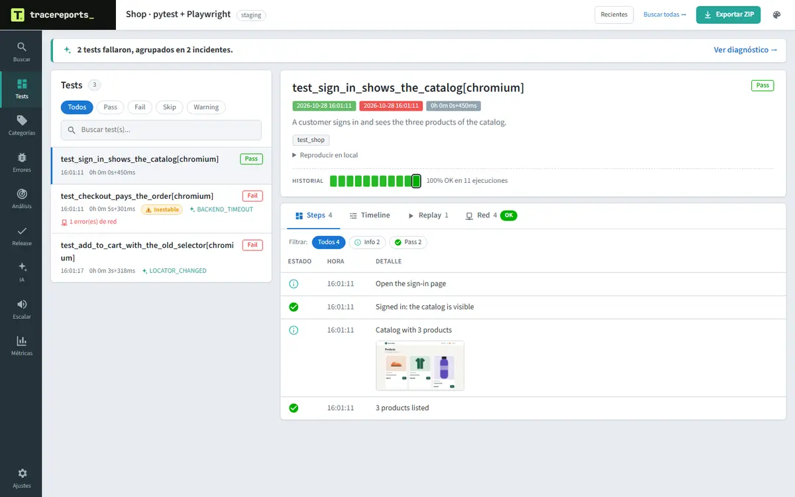
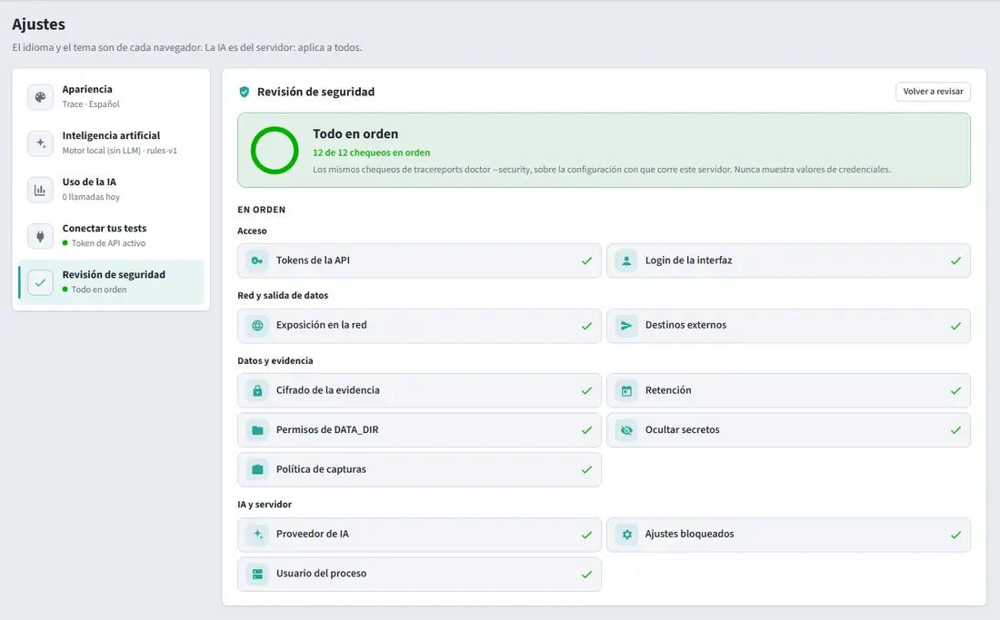
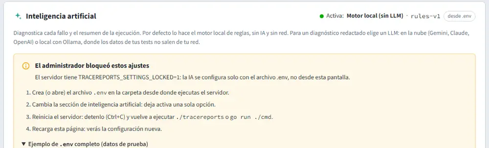
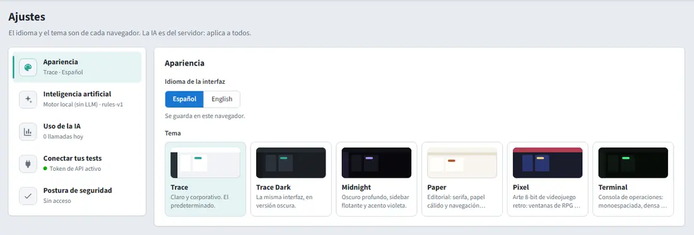
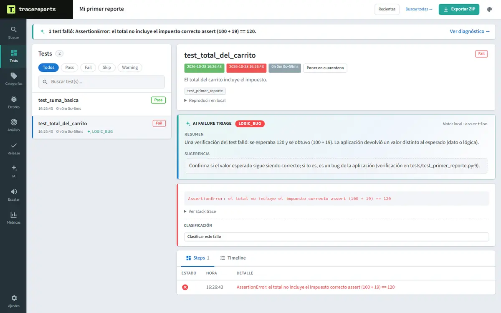
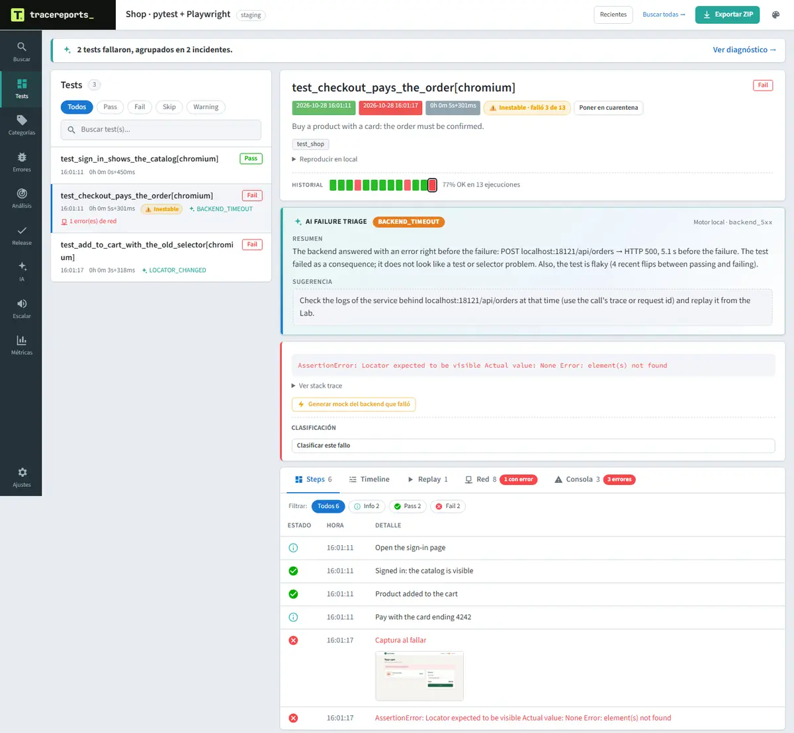
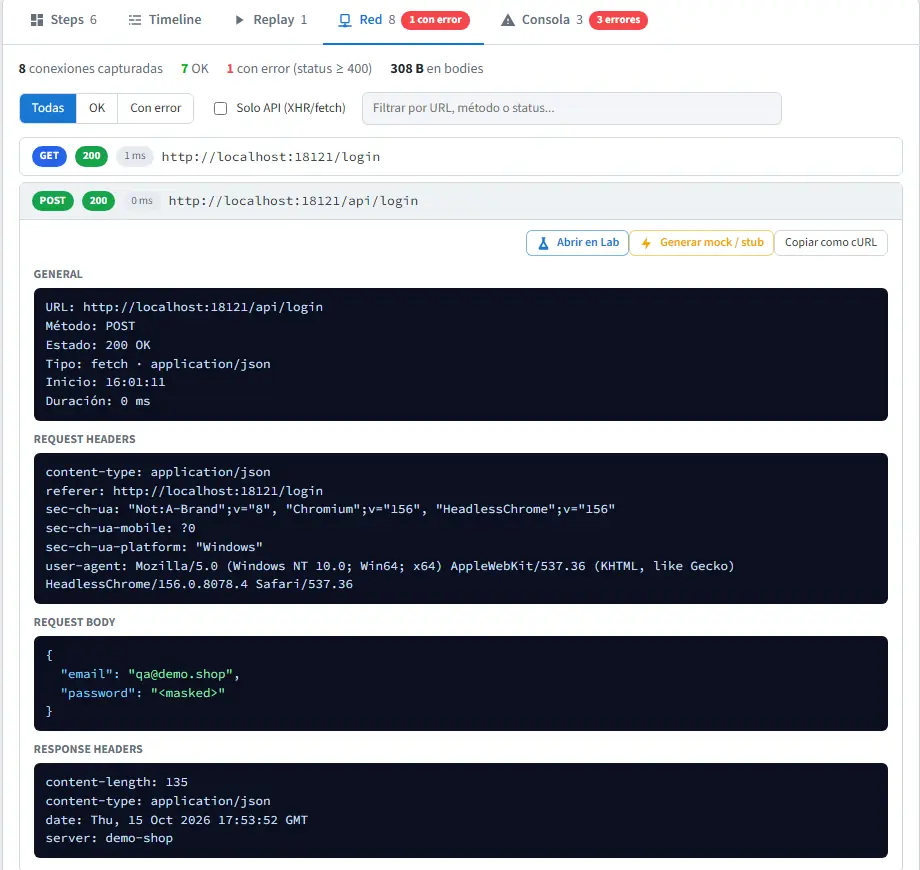

# Instalar TraceReports con Docker, paso a paso

🌐 [English](../en/docker-step-by-step.md) · **Español**

Guía para instalar TraceReports con Docker **desde cero**, aunque nunca hayas usado una terminal. Al final
tendrás TraceReports funcionando con contraseñas seguras, verás tu primera prueba en el reporte y sabrás
comprobar que la seguridad está bien configurada.

**Cómo usarla:** haz los pasos **en orden**. Cada paso tiene:

- 🎯 **Qué vas a hacer** y para qué.
- 💻 **El comando** para copiar y pegar.
- ✅ **Deberías ver**: lo que aparece si salió bien.
- ⚠️ **Si ves esto**: qué hacer si algo sale distinto.

Los comandos están pensados para **Windows (PowerShell)**. Donde cambian en macOS o Linux, hay un bloque
desplegable **"macOS / Linux"** debajo.

> **¿Ya tienes TraceReports instalado con Docker en este equipo?** Lee primero el aviso del final del
> [paso 3](#paso-3--descargar-tracereports).
>
> **Tiempo:** unos 30 minutos. La primera vez Docker descarga y construye la imagen (1 a 3 minutos).
>
> **Ya conoces Docker y solo quieres la referencia?** Ve a [Docker](docker.md). Para un servidor compartido
> en una empresa, después de esta guía sigue la [guía de hardening](security-hardening.md).

---

## Índice

- [Parte A — Preparar](#parte-a--preparar) (pasos 1 a 3)
- [Parte B — Configurar](#parte-b--configurar) (paso 4)
- [Parte C — Arrancar](#parte-c--arrancar) (pasos 5 a 7)
- [Parte D — Entrar y revisar](#parte-d--entrar-y-revisar) (pasos 8 a 10)
- [Parte E — Tu primera prueba](#parte-e--tu-primera-prueba) (pasos 11 a 14)
- [Parte F — Comprobar la seguridad (opcional)](#parte-f--comprobar-la-seguridad-opcional) (pasos 15 a 17)
- [Uso diario](#uso-diario) · [Desinstalar](#desinstalar) · [Problemas frecuentes](#problemas-frecuentes) · [Checklist](#checklist)

---

## Parte A — Preparar

### Paso 1 — Abrir la terminal

🎯 La terminal es la ventana donde escribes los comandos.

**Windows:** presiona la tecla **Windows**, escribe **PowerShell** y presiona **Enter**.
Para **pegar** un comando: clic derecho, o `Ctrl`+`V`. Luego **Enter**.

<details><summary>macOS / Linux</summary>

- **macOS:** `Cmd`+`Espacio`, escribe **Terminal** y presiona Enter. Pegar: `Cmd`+`V`.
- **Linux:** `Ctrl`+`Alt`+`T`. Pegar: `Ctrl`+`Shift`+`V`.

</details>

---

### Paso 2 — Instalar Docker y comprobar que está encendido

🎯 Docker es el programa que va a correr TraceReports en una "caja" aislada y segura (un **contenedor**).

**Si todavía no lo tienes:**

- **Windows y macOS:** instala **Docker Desktop** desde
  [docs.docker.com/desktop](https://docs.docker.com/desktop/) con las opciones por defecto. Ábrelo desde el
  menú Inicio (o Aplicaciones), acepta los términos y espera a que diga **Engine running**.
- **Linux (Ubuntu):** instala Docker Engine siguiendo
  [docs.docker.com/engine/install/ubuntu](https://docs.docker.com/engine/install/ubuntu/).

> Licencia: Docker Desktop requiere suscripción paga en empresas de más de 250 empleados o más de USD 10
> millones de ingresos anuales. Docker Engine en Linux no tiene esa condición.

**Comprueba** que funciona:

💻

```powershell
docker --version
docker compose version
docker info --format "{{.ServerVersion}}"
```

✅ **Deberías ver** tres líneas, por ejemplo:

```
Docker version 29.8.1, build ...
Docker Compose version v5.5.1
29.8.1
```

⚠️ **Si ves esto:**

- `Cannot connect to the Docker daemon`, o la tercera línea da error → Docker no está encendido. Abre
  **Docker Desktop** y espera a que diga **Engine running**. En Windows, si el motor no arranca: abre
  PowerShell **como administrador**, ejecuta `wsl --install --no-distribution` y reinicia el equipo.
- `docker no se reconoce` → cierra la terminal, ábrela de nuevo y repite.

---

### Paso 3 — Descargar TraceReports

🎯 Traer la carpeta del proyecto. Incluye el `docker-compose.yml`, que le dice a Docker cómo correr
TraceReports de forma segura.

Necesitas **git**. Si `git --version` no responde, instálalo desde
[git-scm.com/downloads](https://git-scm.com/downloads) con las opciones por defecto y abre una terminal nueva.

💻

```powershell
cd $HOME
git clone https://github.com/josemiguellopez/tracereports.git
cd tracereports
git switch dev
dir docker-compose.yml, .env.example
```

> **`git switch dev` es obligatorio por ahora:** mientras la próxima versión no esté publicada, las funciones
> de esta guía (login de solo lectura, cifrado de la evidencia, `doctor --security`) están en la rama `dev`.
> Sin ese comando instalarías la versión anterior y no verías esas novedades.

✅ **Deberías ver** que `git clone` descarga el proyecto (`Resolving deltas: 100% ... done.`) y, al final,
los dos archivos listados. `git switch dev` responde `Switched to a new branch 'dev'`.

<details><summary>macOS / Linux</summary>

```bash
cd ~
git clone https://github.com/josemiguellopez/tracereports.git
cd tracereports
ls docker-compose.yml .env.example
```

</details>

> **Regla importante:** los comandos que empiezan con `docker compose` **solo funcionan dentro de la carpeta
> `tracereports`** (donde está el `docker-compose.yml`). Si estás en otra carpeta responden
> `no configuration file provided: not found`. Si cierras la terminal, vuelve con `cd $HOME\tracereports`.

<details>
<summary><b>¿Ya tienes TraceReports instalado con Docker en este equipo?</b> (caso poco común: ábrelo solo si es el tuyo)</summary>

- Si quieres **probar** esta versión y al final **volver a la tuya**, sigue
  [Probar sin tocar tu instalación](docker-prueba-aislada.md) en lugar de esta guía.
- Si quieres que **las dos convivan**: Docker identifica cada instalación por el nombre de su carpeta, así
  que la nueva reemplazaría a la anterior y usaría sus datos. Antes del paso 4, detén la anterior y separa la
  nueva con un `docker-compose.override.yml`, como en los pasos
  [3](docker-prueba-aislada.md#paso-3--encontrar-y-detener-tu-instalación-actual-sin-borrar-nada) y
  [5](docker-prueba-aislada.md#paso-5--separar-la-prueba-de-tu-instalación-muy-importante) de esa guía
  (cambia `prueba` por el nombre que quieras). Desde ahí, los nombres que veas llevarán ese sufijo.

</details>

---

## Parte B — Configurar

### Paso 4 — Crear las contraseñas y el archivo `.env`

🎯 TraceReports **no arranca sin contraseñas**: así nunca queda abierto por error. Este paso crea al azar
todas las que necesita y las guarda en el archivo de configuración `.env`.

| Qué | Para qué |
| --- | --- |
| Token de administración | Contraseña "maestra" de los programas que administran |
| Token de ingesta | Contraseña que usan tus pruebas para enviar resultados (no puede administrar) |
| Clave del usuario `admin` | Entrar al navegador como administrador |
| Clave del usuario `equipo` | Entrar al navegador **solo para mirar** |
| Clave de cifrado | Cifrar las capturas de pantalla guardadas en el disco |

💻 Dentro de la carpeta `tracereports`, copia y pega **todo el bloque** de una vez:

```powershell
function New-Secret { $b = New-Object byte[] 32; [Security.Cryptography.RandomNumberGenerator]::Create().GetBytes($b); -join ($b | ForEach-Object { $_.ToString("x2") }) }
$b = New-Object byte[] 32; [Security.Cryptography.RandomNumberGenerator]::Create().GetBytes($b); $dbkey = [Convert]::ToBase64String($b)
$lines = @(
  "# TraceReports",
  "TRACEREPORTS_TOKEN=$(New-Secret)",
  "TRACEREPORTS_INGEST_TOKEN=$(New-Secret)",
  "TRACEREPORTS_UI_USER=admin",
  "TRACEREPORTS_UI_PASSWORD=$(New-Secret)",
  "TRACEREPORTS_UI_VIEWER_USER=equipo",
  "TRACEREPORTS_UI_VIEWER_PASSWORD=$(New-Secret)",
  "TRACEREPORTS_SETTINGS_LOCKED=1",
  "TRACEREPORTS_RETENTION_DAYS=90",
  "TRACEREPORTS_SCREENSHOTS=failures",
  "TRACEREPORTS_ENCRYPT_AT_REST=1",
  "TRACEREPORTS_DB_KEY=$dbkey",
  "AI_PROVIDER=builtin",
  "TRACEREPORTS_AI_ALLOWED_PROVIDERS=builtin",
  "NOTIFY_DETAIL=minimal"
)
[IO.File]::WriteAllLines("$PWD\.env", $lines, (New-Object Text.UTF8Encoding($false)))
Get-Content .env | Select-String "_USER=|_PASSWORD="
```

✅ **Deberías ver** tus usuarios y sus claves (64 letras y números cada una):

```
TRACEREPORTS_UI_USER=admin
TRACEREPORTS_UI_PASSWORD=3f9a0c...e71b
TRACEREPORTS_UI_VIEWER_USER=equipo
TRACEREPORTS_UI_VIEWER_PASSWORD=8b21dd...04aa
```

Para ver las claves más adelante: `Get-Content .env` (dentro de la carpeta `tracereports`).

> **Muy importante:**
>
> - **Guarda una copia** de las claves en tu gestor de contraseñas. La `TRACEREPORTS_DB_KEY` es la única
>   forma de leer las capturas cifradas: si la pierdes, no se pueden recuperar.
> - El `.env` tiene contraseñas: **nunca lo subas a git ni lo compartas** por chat o correo.

<details><summary>macOS / Linux</summary>

```bash
cat > .env <<EOF
# TraceReports
TRACEREPORTS_TOKEN=$(openssl rand -hex 32)
TRACEREPORTS_INGEST_TOKEN=$(openssl rand -hex 32)
TRACEREPORTS_UI_USER=admin
TRACEREPORTS_UI_PASSWORD=$(openssl rand -hex 32)
TRACEREPORTS_UI_VIEWER_USER=equipo
TRACEREPORTS_UI_VIEWER_PASSWORD=$(openssl rand -hex 32)
TRACEREPORTS_SETTINGS_LOCKED=1
TRACEREPORTS_RETENTION_DAYS=90
TRACEREPORTS_SCREENSHOTS=failures
TRACEREPORTS_ENCRYPT_AT_REST=1
TRACEREPORTS_DB_KEY=$(openssl rand -base64 32)
AI_PROVIDER=builtin
TRACEREPORTS_AI_ALLOWED_PROVIDERS=builtin
NOTIFY_DETAIL=minimal
EOF
chmod 600 .env
grep -E "_USER=|_PASSWORD=" .env
```

</details>

Qué significa cada línea:

| Línea | Qué hace |
| --- | --- |
| `TRACEREPORTS_TOKEN` / `TRACEREPORTS_INGEST_TOKEN` | Las contraseñas de los programas |
| `TRACEREPORTS_UI_USER` / `TRACEREPORTS_UI_PASSWORD` | Login de administración |
| `TRACEREPORTS_UI_VIEWER_USER` / `TRACEREPORTS_UI_VIEWER_PASSWORD` | Login de solo lectura |
| `TRACEREPORTS_SETTINGS_LOCKED=1` | Nadie cambia la configuración desde la pantalla; solo desde este archivo |
| `TRACEREPORTS_RETENTION_DAYS=90` | Borra automáticamente lo que tenga más de 90 días |
| `TRACEREPORTS_SCREENSHOTS=failures` | Guarda capturas solo de lo que falló |
| `TRACEREPORTS_ENCRYPT_AT_REST=1` + `TRACEREPORTS_DB_KEY` | Cifra capturas, videos y DOM |
| `AI_PROVIDER=builtin` | Diagnóstico con reglas locales: **ningún dato sale** de tu equipo |
| `NOTIFY_DETAIL=minimal` | Si conectas Teams o Slack, no se envían nombres de pruebas ni errores |

Todas las opciones están en [Configuración](configuration.md).

---

## Parte C — Arrancar

### Paso 5 — Construir y arrancar TraceReports

🎯 Docker construye la imagen de TraceReports y la pone en marcha **en segundo plano**.

💻

```powershell
docker compose up -d
```

✅ **Deberías ver** que descarga y construye (la primera vez, 1 a 3 minutos) y termina así:

```
 ✔ Image tracereports:latest                     Built
 ✔ Network tracereports_default                  Created
 ✔ Volume tracereports-data                      Created
 ✔ Container tracereports-tracereports-1         Started
```

⚠️ **Si ves esto:**

- `port is already allocated` → otro programa usa el puerto 8080 (¿otra instalación de TraceReports?).
  Mira el aviso del final del [paso 3](#paso-3--descargar-tracereports).
- Un error de red al descargar → revisa tu conexión y repite.

---

### Paso 6 — Comprobar que está sano

💻

```powershell
docker compose ps
```

✅ **Deberías ver** el contenedor con estado **`Up`** y, a los pocos segundos, **`(healthy)`**:

```
NAME                          IMAGE                 STATUS                    PORTS
tracereports-tracereports-1   tracereports:latest   Up 12 seconds (healthy)   127.0.0.1:8080->8080/tcp, [::1]:8080->8080/tcp
```

Si dice `(health: starting)`, espera 20 segundos y repite el comando. Si dice **`Restarting`**, mira el
paso 7.

> El puerto queda publicado **solo para este equipo** (`127.0.0.1`): nadie más en tu red puede entrar. Para
> compartirlo con tu equipo, ver [Docker → Desplegar en un servidor](docker.md#desplegar-en-un-servidor).

---

### Paso 7 — Mirar los registros (logs)

🎯 Los logs dicen qué hace TraceReports y si hay algún problema.

💻

```powershell
docker compose logs --tail 25 tracereports
```

✅ **Deberías ver** estas líneas (las fechas cambian):

```
INFO evidence encrypted at rest (screenshots, traces, videos, DOM) key_id=1ad8abcbce9c5cd3
INFO screenshot policy screenshots=failures
INFO failure diagnosis: local rules engine (no LLM, no network); ...
INFO egress: no external destination configured (nothing leaves this server)
INFO retention enabled days=90
INFO TraceReports listening url=http://localhost:8080 bind=""
```

⚠️ **Si ves esto:**

- `refusing to start` → faltan las contraseñas: el `.env` no se creó bien o no está en esta carpeta.
  Repite el **paso 4** y luego `docker compose up -d`.
- Un mensaje con `DB_KEY` → la clave de cifrado quedó mal. Repite el **paso 4** y luego
  `docker compose up -d`.

---

## Parte D — Entrar y revisar

### Paso 8 — Entrar como administrador

1. Abre el navegador en **http://localhost:8080**
2. Aparece una ventana que pide **usuario y contraseña**:
   - Usuario: `admin`
   - Contraseña: el valor de `TRACEREPORTS_UI_PASSWORD` del `.env` (cópialo y pégalo).

✅ **Deberías ver** la pantalla de TraceReports. Al principio está **vacía** porque aún no hay pruebas. Así
se ve cuando ya tiene resultados:



⚠️ **Si la ventana pide la clave una y otra vez:** la clave no coincide con el `.env`. Cópiala de nuevo,
sin espacios al final.

---

### Paso 9 — Revisar la seguridad

🎯 TraceReports revisa su propia configuración de seguridad.

En el navegador: **Ajustes** (abajo a la izquierda) → **Revisión de seguridad**.



✅ La mayoría en verde (**OK**). Con Docker en tu equipo es normal que **"Exposición en la red"** aparezca
arriba, en **Para revisar**: dentro del contenedor TraceReports escucha en la red *del contenedor*, aunque el puerto solo
esté publicado para tu equipo. Para dejarlo en verde mira el paso opcional del final de este paso; en un servidor,
la [guía de hardening](security-hardening.md).

Lo mismo por comando (dentro de la carpeta `tracereports`):

💻

```powershell
docker compose exec tracereports /tracereports doctor --security
```

✅ **Deberías ver** (salida real de una instalación con esta guía):

```
OK    API tokens                   admin and ingest tokens set and different
OK    UI login                     reads require the UI login or a token
WARN  Network exposure             inside Docker it listens on the container network; if the port is published only on 127.0.0.1 (the official docker-compose.yml), only this machine reaches it
                                   → to filter inside Docker too, set TRACEREPORTS_ALLOWED_CIDRS to the container network (docker network inspect <project>_default) or the networks that need it
OK    AI provider                  local rules engine or off: no evidence leaves the server
OK    Settings locked              Settings is read-only: the configuration comes only from the environment
OK    Retention                    runs older than 90 days are deleted (secure_delete, VACUUM)
OK    Evidence encryption at rest  screenshots, traces, videos and DOM encrypted (AES-256-GCM), key outside DATA_DIR
OK    Process user                 unprivileged user (uid 65532)
OK    DATA_DIR permissions         0700: only the server user
OK    Outbound destinations        none: no data leaves the server
OK    Secret redaction             secrets in headers, bodies and logs are masked before storing
OK    Screenshot policy            TRACEREPORTS_SCREENSHOTS=failures

11 ok, 1 warn, 0 fail
```

Lo importante es **`0 fail`**.

<details>
<summary><b>Opcional: dejar en verde «Exposición en la red»</b></summary>

En tu equipo ya estás protegido: el `docker-compose.yml` publica el puerto solo para `127.0.0.1`, así que nadie
de tu red llega a él. Si además quieres que TraceReports rechace cualquier conexión que no venga de la red de
Docker, limítalo a esa red. Hazlo en **la misma ventana** de la terminal, dentro de la carpeta `tracereports`:

1. Mira la red de tu instalación:

   💻

   ```powershell
   $red = docker network inspect tracereports_default --format "{{(index .IPAM.Config 0).Subnet}}"; $red
   ```

   ✅ **Deberías ver** algo como `172.18.0.0/16` (los números pueden ser otros).

2. Guárdala en el `.env`:

   ```powershell
   $e = Get-Content .env | Where-Object { $_ -notmatch '^TRACEREPORTS_ALLOWED_CIDRS=' }; $e += "TRACEREPORTS_ALLOWED_CIDRS=$red"; [IO.File]::WriteAllLines("$PWD\.env", $e, (New-Object Text.UTF8Encoding($false)))
   ```

3. Aplícalo:

   ```powershell
   docker compose up -d
   ```

4. Compruébalo:

   ```powershell
   curl.exe -s -o NUL -w "%{http_code}" http://localhost:8080/api/v1/runs
   ```

   ✅ **`401`** (pide login): está bien, el filtro te deja pasar. Recarga **Ajustes → Revisión de seguridad**:
   "Exposición en la red" pasa a **En orden** ("solo desde 172.18.0.0/16").

   ❌ **`403`**: tu Docker muestra las conexiones desde otra dirección. Búscala en el log:

   ```powershell
   docker compose logs tracereports | Select-String "not in TRACEREPORTS_ALLOWED_CIDRS"
   ```

   La línea termina con `ip=…`. Repite el paso 2 con esa IP, por ejemplo después de `$red = "192.168.65.1/32"`, y
   el paso 3.

**Para deshacerlo:**

```powershell
$e = Get-Content .env | Where-Object { $_ -notmatch '^TRACEREPORTS_ALLOWED_CIDRS=' }; [IO.File]::WriteAllLines("$PWD\.env", $e, (New-Object Text.UTF8Encoding($false)))
```

y después `docker compose up -d`.

<details><summary>macOS / Linux</summary>

```bash
red=$(docker network inspect tracereports_default --format '{{(index .IPAM.Config 0).Subnet}}'); echo "$red"
grep -v '^TRACEREPORTS_ALLOWED_CIDRS=' .env > .env.tmp && echo "TRACEREPORTS_ALLOWED_CIDRS=$red" >> .env.tmp && mv .env.tmp .env
docker compose up -d
curl -s -o /dev/null -w "%{http_code}\n" http://localhost:8080/api/v1/runs
```

Con `403`: `docker compose logs tracereports | grep "not in TRACEREPORTS_ALLOWED_CIDRS"`. Para deshacerlo:
`grep -v '^TRACEREPORTS_ALLOWED_CIDRS=' .env > .env.tmp && mv .env.tmp .env` y `docker compose up -d`.

</details>
</details>

En **Ajustes → Inteligencia artificial** verás **"El administrador bloqueó estos ajustes"**: es por
`TRACEREPORTS_SETTINGS_LOCKED=1`, como debe ser.



---

### Paso 10 — Entrar como usuario de solo lectura

🎯 Comprobar que el usuario `equipo` puede mirar pero **no** administrar.

1. Abre una **ventana privada** del navegador (`Ctrl`+`Shift`+`N` en Chrome o Edge). El navegador recuerda
   el login anterior; la ventana privada te deja entrar con otro usuario.
2. Ve a **http://localhost:8080**.
3. Usuario: `equipo`. Contraseña: `TRACEREPORTS_UI_VIEWER_PASSWORD` del `.env`.

✅ Ve los mismos reportes, pero en **Ajustes** la **Revisión de seguridad** dice **"Sin acceso"**:



Cierra la ventana privada.

---

## Parte E — Tu primera prueba

### Paso 11 — Preparar Python (en otra terminal)

🎯 Vamos a correr una prueba automática con **pytest** (Python) que envía sus resultados a TraceReports.

Necesitas **Python 3**. Si `python --version` no responde, instálalo desde
[python.org/downloads](https://www.python.org/downloads/) y en el instalador marca
**"Add python.exe to PATH"**.

Abre **otra** terminal (deja la primera abierta) y pega:

💻

```powershell
mkdir $HOME\mis-pruebas
cd $HOME\mis-pruebas
python -m venv .venv
.venv\Scripts\Activate.ps1
pip install pytest $HOME\tracereports\client\python
```

✅ **Deberías ver** que el inicio de la línea cambia a `(.venv) PS ...\mis-pruebas>` y que `pip` termina con
`Successfully installed ... pytest ... tracereports ...`.

⚠️ **Si ves** `la ejecución de scripts está deshabilitada en este sistema`: pega
`Set-ExecutionPolicy -Scope CurrentUser RemoteSigned`, responde **S** y repite las dos últimas líneas.

<details><summary>macOS / Linux</summary>

```bash
mkdir -p ~/mis-pruebas && cd ~/mis-pruebas
python3 -m venv .venv
source .venv/bin/activate
pip install pytest ~/tracereports/client/python
```

</details>

---

### Paso 12 — Crear una prueba de ejemplo

🎯 Dos pruebas: una pasa y otra **falla a propósito**, para ver cómo se muestra un fallo.

💻 Pega **todo el bloque**:

```powershell
@'
def test_suma_basica():
    """La suma de dos numeros da el resultado esperado."""
    assert 2 + 2 == 4


def test_total_del_carrito():
    """El total del carrito incluye el impuesto."""
    precio, impuesto = 100, 19
    assert precio + impuesto == 120, "el total no incluye el impuesto correcto"
'@ | Set-Content -Encoding utf8 test_primer_reporte.py
dir test_primer_reporte.py
```

✅ Se lista el archivo `test_primer_reporte.py`.

<details><summary>macOS / Linux</summary>

```bash
cat > test_primer_reporte.py <<'EOF'
def test_suma_basica():
    """La suma de dos numeros da el resultado esperado."""
    assert 2 + 2 == 4


def test_total_del_carrito():
    """El total del carrito incluye el impuesto."""
    precio, impuesto = 100, 19
    assert precio + impuesto == 120, "el total no incluye el impuesto correcto"
EOF
```

</details>

---

### Paso 13 — Correr la prueba y enviar los resultados

🎯 Las pruebas usan el **token de ingesta** (el que solo envía resultados). Este bloque lo **lee solo**
desde el `.env`: no tienes que copiar nada a mano.

💻 Pega **todo el bloque**:

```powershell
$env:TRACEREPORTS_URL = "http://127.0.0.1:8080"
$env:TRACEREPORTS_TOKEN = ((Get-Content $HOME\tracereports\.env | Select-String '^TRACEREPORTS_INGEST_TOKEN=').Line -split '=', 2)[1]
"Token cargado: " + $env:TRACEREPORTS_TOKEN.Length + " caracteres"
pytest --tracereports --tracereports-run "Mi primer reporte"
```

✅ **Deberías ver** primero `Token cargado: 64 caracteres` y al final (salida real):

```
test_primer_reporte.py .F                                                       [100%]
...
E       AssertionError: el total no incluye el impuesto correcto
E       assert (100 + 19) == 120
TraceReports: http://127.0.0.1:8080/#run=1&view=dashboard
FAILED test_primer_reporte.py::test_total_del_carrito - AssertionError: el total no incluye el impuesto correcto
========================= 1 failed, 1 passed in 0.11s =========================
```

> Que **1 falle** es lo esperado: lo hicimos a propósito.

⚠️ **Si ves esto:**

- `Token cargado: 0 caracteres` → no encontró el `.env`. Revisa que existe `$HOME\tracereports\.env`
  (paso 4).
- Un aviso **401** o no aparece la línea `TraceReports:` → el token no coincide con el del servidor. Si
  cambiaste el `.env` después de arrancar, aplica los cambios con `docker compose up -d` (en la carpeta
  `tracereports`).
- Se creó una carpeta `tracereports-offline` → TraceReports no respondía. Revisa el paso 6.

> En Windows usa `http://127.0.0.1:8080` y no `localhost` para las pruebas: con `localhost` cada conexión
> puede tardar unos 2 segundos.

<details><summary>macOS / Linux</summary>

```bash
export TRACEREPORTS_URL=http://127.0.0.1:8080
export TRACEREPORTS_TOKEN="$(grep '^TRACEREPORTS_INGEST_TOKEN=' ~/tracereports/.env | cut -d= -f2-)"
echo "Token cargado: ${#TRACEREPORTS_TOKEN} caracteres"
pytest --tracereports --tracereports-run "Mi primer reporte"
```

</details>

---

### Paso 14 — Ver el reporte

1. Vuelve al navegador donde entraste como `admin` (o abre **http://localhost:8080**).
2. Recarga la página (`F5`).

✅ **Deberías ver** la ejecución **"Mi primer reporte"** con **1 test OK y 1 fallido**. Haz clic en
`test_total_del_carrito`:



- Arriba, el **diagnóstico** del motor local: se esperaba 120 y se obtuvo `(100 + 19)`.
- Abajo, el **error** y los **pasos**.

Con pruebas de navegador (Playwright o Selenium), cada test fallido además trae sus **capturas de
pantalla** y las **llamadas de red**, con las contraseñas enmascaradas:





Para conectar tus pruebas reales (Playwright, Selenium, JUnit 5, Go), mira **Ajustes → Conectar tus tests**
o la documentación de cada cliente: [Python](python.md), [JavaScript](javascript.md), [Java](java.md),
[Go](go.md).

🎉 **TraceReports está instalado y funcionando.**

---

## Parte F — Comprobar la seguridad (opcional)

Estos pasos comprueban que las protecciones funcionan. Hazlos en la terminal de Python (la del paso 11).

### Paso 15 — Las capturas se guardan cifradas

🎯 Enviamos una captura de pantalla de un paso fallido y revisamos que en el disco quede **cifrada**, pero en
la pantalla se vea normal.

💻 Pega **todo el bloque** (crea una imagen de prueba y la envía con el token de ingesta):

```powershell
$T = ((Get-Content $HOME\tracereports\.env | Select-String '^TRACEREPORTS_INGEST_TOKEN=').Line -split '=', 2)[1]
$B = "http://127.0.0.1:8080/api/v1"
$H = @{ Authorization = "Bearer $T" }
Add-Type -AssemblyName System.Drawing
$bmp = New-Object Drawing.Bitmap 400, 200
$g = [Drawing.Graphics]::FromImage($bmp); $g.Clear([Drawing.Color]::SteelBlue)
$g.DrawString("captura de prueba", (New-Object Drawing.Font "Arial", 20), [Drawing.Brushes]::White, 20, 80)
$bmp.Save("$PWD\captura.png", [Drawing.Imaging.ImageFormat]::Png); $g.Dispose(); $bmp.Dispose()
$run  = Invoke-RestMethod -Method Post -Headers $H -ContentType "application/json" -Uri "$B/runs" -Body '{"name":"Prueba con captura"}'
$test = Invoke-RestMethod -Method Post -Headers $H -ContentType "application/json" -Uri "$B/runs/$($run.run_id)/tests" -Body '{"name":"Login falla"}'
curl.exe -s -H "Authorization: Bearer $T" -F "file=@captura.png" -F "status=FAIL" -F "message=pantalla del fallo" "$B/tests/$($test.test_id)/screenshot"
Invoke-RestMethod -Method Patch -Headers $H -ContentType "application/json" -Uri "$B/tests/$($test.test_id)/finish" -Body '{"status":"FAIL","error_message":"TimeoutError: no apareció el dashboard"}' | Out-Null
Invoke-RestMethod -Method Patch -Headers $H -Uri "$B/runs/$($run.run_id)/finish" | Out-Null
```

✅ La línea de `curl.exe` responde un texto que empieza con `{"log":` y termina con `"url":"/screenshots/..."`.

Ahora revisa cómo quedó guardada. Ve a la carpeta `tracereports` y pregúntale al contenedor:

```powershell
cd $HOME\tracereports
docker compose exec tracereports /tracereports evidence status
cd $HOME\mis-pruebas
```

✅ **Deberías ver** (salida real):

```
files: 1 encrypted (current key 1ad8abcbce9c5cd3)
DOM snapshots: none
```

La captura está **cifrada** en el disco. En el navegador, abre **"Prueba con captura" → "Login falla"**: la
captura azul **se ve normal**.

---

### Paso 16 — El token de ingesta no puede administrar

🎯 El token de tus pruebas no debe poder ver la configuración de seguridad.

💻 (sigue definido `$H` del paso 15):

```powershell
try { Invoke-RestMethod -Headers $H -Uri "$B/security/posture" } catch { $_.Exception.Response.StatusCode.value__ }
```

✅ **Deberías ver:** `403` (prohibido). Correcto.

---

### Paso 17 — El freno a las claves equivocadas (hazlo al final)

🎯 Después de **10 claves malas** seguidas, TraceReports bloquea esa conexión 15 minutos.

> ⚠️ Esto también bloqueará **tu navegador** 15 minutos. Para desbloquearlo antes, reinicia TraceReports:
> `docker compose restart` (en la carpeta `tracereports`).

💻

```powershell
1..10 | ForEach-Object { curl.exe -s -o NUL -w "%{http_code} " -u "admin:clave-mala" http://127.0.0.1:8080/api/v1/runs }
""
```

✅ **Deberías ver** diez veces `401`. Ahora con la clave **correcta** (el bloque la lee sola del `.env`):

```powershell
$P = ((Get-Content $HOME\tracereports\.env | Select-String '^TRACEREPORTS_UI_PASSWORD=').Line -split '=', 2)[1]
curl.exe -s -o NUL -w "%{http_code}`n" -u "admin:$P" http://127.0.0.1:8080/api/v1/runs
```

✅ **Deberías ver:** `429` (demasiados intentos), aunque la clave sea correcta. Así funciona el freno.

---

## Uso diario

Siempre dentro de la carpeta `tracereports`:

| Qué quieres | Comando |
| --- | --- |
| Ver si está corriendo | `docker compose ps` |
| Ver los logs | `docker compose logs -f tracereports` (`Ctrl`+`C` para salir) |
| Reiniciar | `docker compose restart` |
| Detener (los datos se conservan) | `docker compose stop` |
| Volver a encender | `docker compose start` |
| Aplicar cambios del `.env` | `docker compose up -d` |
| Actualizar a una versión nueva | Haz un respaldo, luego `git pull` y `docker compose up -d --build` |
| Revisar la seguridad | `docker compose exec tracereports /tracereports doctor --security` |

> **Nunca** uses `docker compose down -v` si quieres conservar tus datos: la `-v` **borra el volumen con
> todos los datos**.

Para el **respaldo** de los datos, ver [Docker → Backup y restauración](docker.md#backup-y-restauración).
Para que otras personas entren (HTTPS, red permitida, firewall), ver
[Docker → Desplegar en un servidor](docker.md#desplegar-en-un-servidor) y la
[guía de hardening](security-hardening.md).

---

## Desinstalar

Solo si quieres **borrar TraceReports y todos sus datos**. Pega **una línea a la vez** (si pegas varias
juntas, a veces dos se unen en una y el comando falla).

1. Sal del entorno de Python y vuelve a la carpeta `tracereports`:

   ```powershell
   deactivate
   ```

   ```powershell
   cd $HOME\tracereports
   ```

2. Borra el contenedor y **los datos** (el volumen):

   ```powershell
   docker compose down -v
   ```

3. Borra la imagen:

   ```powershell
   docker image rm tracereports:latest
   ```

   Si separaste esta instalación de otra (aviso del paso 3), la imagen lleva el nombre que elegiste
   (`tracereports:<nombre>`), y `down -v` borró solo los datos de esta: la otra sigue intacta.

4. Cierra la otra terminal, el Bloc de notas y cualquier ventana del Explorador que esté en esas carpetas, y
   borra las carpetas:

   ```powershell
   cd $HOME
   ```

   ```powershell
   Remove-Item -Recurse -Force $HOME\tracereports, $HOME\mis-pruebas
   ```

⚠️ Si dice `está siendo utilizado en otro proceso`, todavía hay algo abierto en esa carpeta: cierra esta
terminal, abre una nueva y repite solo la última línea.

---

## Problemas frecuentes

| Lo que ves | Qué hacer |
| --- | --- |
| `no configuration file provided: not found` | Estás fuera de la carpeta `tracereports`. Haz `cd $HOME\tracereports` |
| `Cannot connect to the Docker daemon` | Docker está apagado: abre Docker Desktop y espera **Engine running** |
| `port is already allocated` | Otra instalación usa el puerto 8080. Ver el aviso del final del [paso 3](#paso-3--descargar-tracereports) |
| El log dice `refusing to start` | Faltan las contraseñas en el `.env`: repite el paso 4 y `docker compose up -d` |
| `missing or invalid API token` | El token no es el de ingesta del `.env`, o tiene un texto de ejemplo sin reemplazar |
| El navegador pide la clave una y otra vez | La clave no coincide con el `.env` |
| `429` | 10 claves malas en 15 minutos: espera o `docker compose restart` |
| `has no container to start` | Estás en otra carpeta: ve a la carpeta donde instalaste TraceReports |
| No se puede borrar la carpeta | Algo la tiene abierta: cierra terminales, Bloc de notas y Explorador |

Más casos en [Docker → Problemas frecuentes](docker.md#problemas-frecuentes).

---

## Checklist

- [ ] 2 — Docker encendido (`docker info` responde)
- [ ] 3 — Proyecto descargado
- [ ] 4 — `.env` con contraseñas creado y claves guardadas en tu gestor de contraseñas
- [ ] 5–6 — Contenedor `Up (healthy)`
- [ ] 7 — Logs con `evidence encrypted at rest`
- [ ] 8 — Entré como `admin`
- [ ] 9 — `doctor --security` con `0 fail`
- [ ] 10 — `equipo` ve pero no administra
- [ ] 13–14 — Primera prueba enviada y visible en el reporte
- [ ] 15–17 (opcional) — Captura cifrada, el token de ingesta da `403` y el freno da `429`
